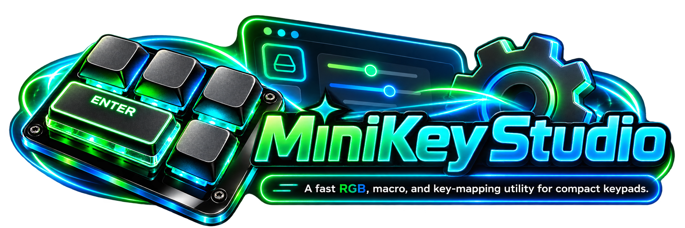
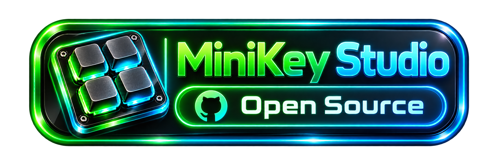
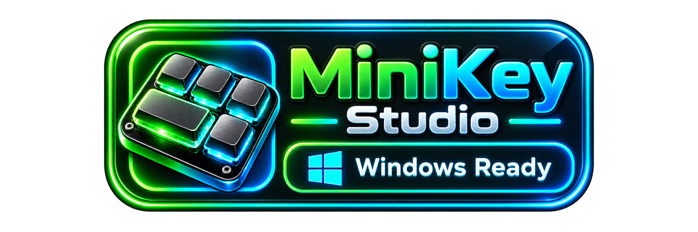
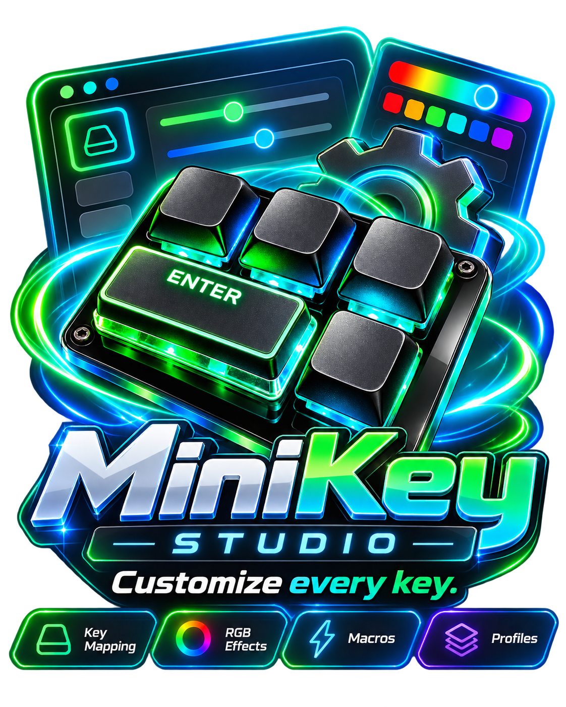
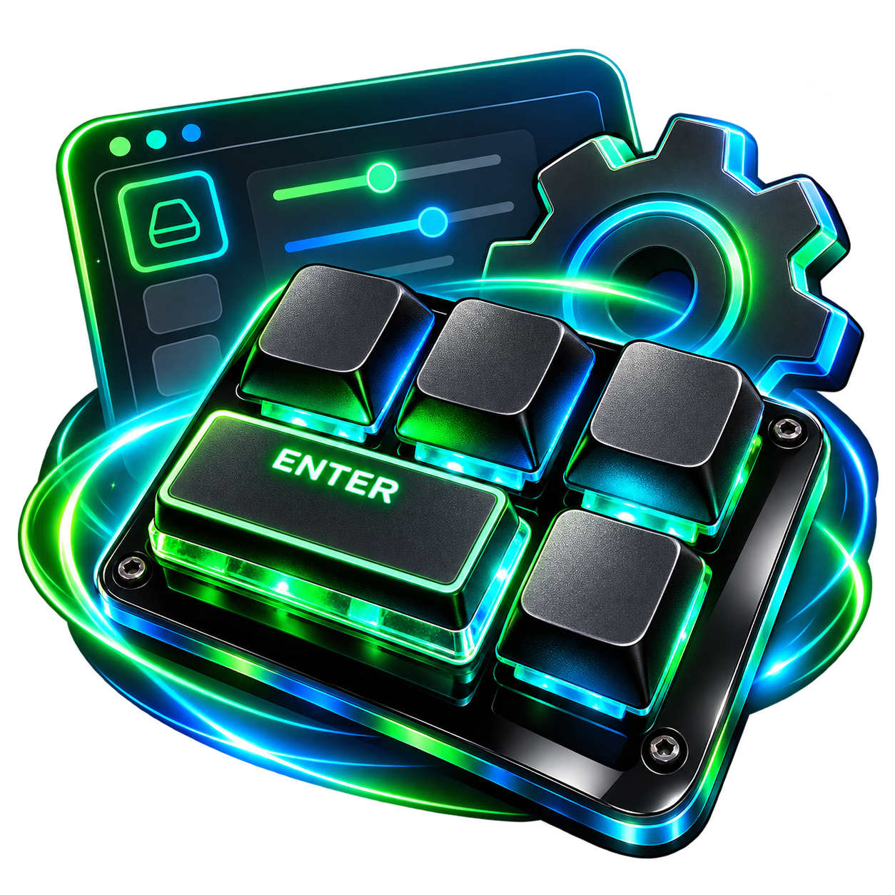
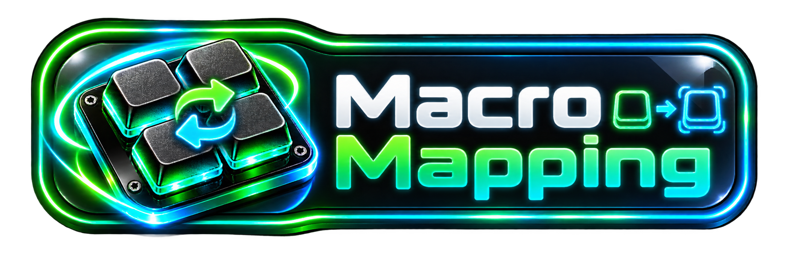
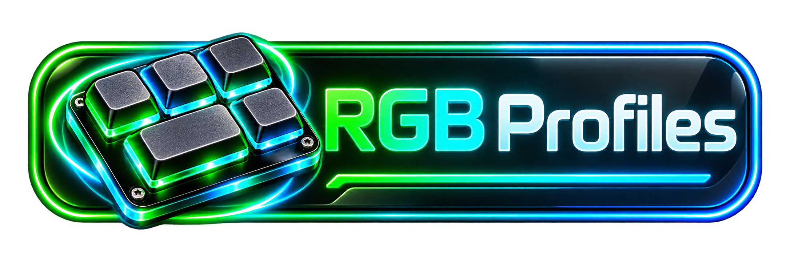
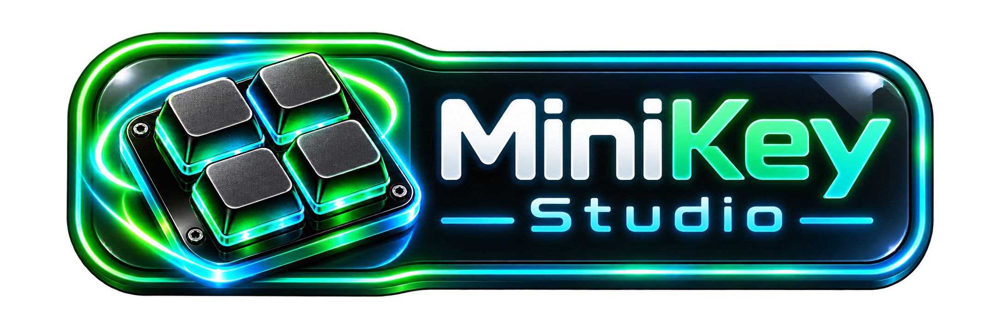

# MiniKeyboard

<p align="center">
  
</p>

<p align="center">
  
  
</p>

Configurator and reverse-engineering workspace for a small USB HID macro keyboard ("KEY_PRO",
VID `0x514C` / `0x1189`, PID `0x88xx`) and its original configuration software.

<p align="center">
  
</p>

## The configurator (`app/`)



A Tauri 2 / Rust desktop app with a plain HTML/CSS/JS front end.

```bash
cd app
npx tauri dev          # run
npx tauri build        # release build
cd src-tauri && cargo test                       # unit tests
cd src-tauri && cargo test -- --ignored          # read-only check against a connected keyboard
```

Closing the window hides it to the system tray so key actions, sounds and layer keys keep working;
quit from the tray icon.

### Keys



Assign any key (or knob action) on any of the 3 layers: **Keystroke**, **Combination**,
**Mouse** (clicks, wheel, with modifiers), **System** (volume, media, brightness, browser, apps) or
**Macro**. Key capture lets you press the key instead of picking it. Changes are written to the
keyboard automatically about 0.7 s after the last edit (switch this off on the Device tab), then
read back and verified.

### Macros
Record or build a sequence (up to 18 steps, one delay between steps, 50–60000 ms), test it in the
app with a timed log and typed-output preview, then assign it to a key. The library saves automatically.

### Actions and Soundboard
Give one key several jobs. Each **key action** is a list of "when this key..." rows, each one a
trigger plus an action:

- **On press** / **On release**: happens once.
- **While held**: starts on press and ends on release. A sound plays (optionally looping) and stops;
  a key stays down.
- Actions: **Play sound**, **Press key** (any key plus modifiers), **Run program**, **Run script**
  (.ps1, .bat, .cmd, .py or any program).

So "press: play a sound", "hold: play a sound while held" and "press: press a second key" are all just
rows on the same key. The **Soundboard** is the library of sounds (mp3, wav, ogg, flac, m4a) with
per-sound volume, a play/stop button and "Bind to a key".

The keyboard cannot run any of this itself: each key action owns a rarely used hotkey
(`Ctrl+Shift+Alt+F13`-`F24`, 12 in total shared with layer keys) that you assign to a key, and the app
reacts to its press and release. The app must be running (the tray is fine). Injected keys are sent
as hardware scancodes; the trigger's own Ctrl+Shift+Alt are lifted first so they do not leak into them.

### Clipboard (text blocks)
A library of text blocks (replies, addresses, code, prompts). Bind one to a key as **Type text**
(sends each character) or **Paste text** (sets the clipboard and presses Ctrl+V; the previous clipboard
is restored). **Press Enter after** sends the text immediately; it is a toggle per action, on by
default (the default itself is in Settings). **From clipboard** captures whatever you just copied.
Text actions are also available as rows in any key action.

### Layers
The keyboard itself only uses layer 1. **Layer keys** (go to, toggle, cycle, hold) are software
layers: the app rewrites the keys that differ between layers. Each switch is a flash write
(about 0.25 s) and flash wears out, so keep layers similar, avoid very frequent switching and
prefer toggle/go-to over hold.

### Lighting



Colour (7 presets) and animation per layer: Off, Static, Reactive, Reactive alternate, When pressed,
Cycle (ignores the colour). Applied automatically. The keyboard cannot report its lighting and has
no brightness control; both were probed on hardware.

### Settings
Auto-write and auto-light, close to tray, start with Windows (hidden in the tray), accent colour,
text defaults (Enter after, typing delay, restore clipboard), master volume, open the data folder,
export/import the whole library, reset app data.

## Repository layout

- `app/` — the configurator (`src/` front end, `src-tauri/` Rust backend and HID code).
- `PROTOCOL.md` — the reverse-engineered HID protocol: enumeration, handshake, key slots, key
  modes, LED, plus the original app's type-10 (per-key RGB) paths.
- `src/kb_client.py` — small Python HID client (auto-loads the 32/64-bit `hidapi` DLL).
- `_Original/` — the original `MINI_KEYBOARD.exe`, its Qt 5.14 runtime and `hidapi` DLLs (git-ignored).
- `Images/` — artwork used here. `Icon_Solo.png` is the application icon; the files in
  `app/src-tauri/icons/` are generated from it with `npx tauri icon ../Images/Icon_Solo.png`.

```bash
python src/kb_client.py     # prints the opened VID/PID and the handshake
```

## Notes

- All reports are 65 bytes including report ID `0x03`; multi-byte integers are little-endian unless
  `PROTOCOL.md` says otherwise.
- Key and macro encodings, key modes and the layer/slot layout were verified on a 5-key unit by
  writing, reading back and restoring. The LED command comes from the original app's code.
- Per-key RGB models (device type 10) are documented in `PROTOCOL.md` but not implemented in the app.
- Custom firmware is not part of this repo: the MCU is unidentified and flashing is risky.

<p align="center">
  
</p>
